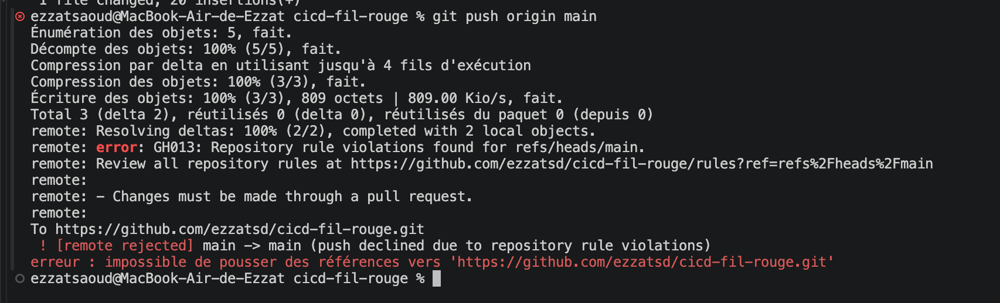
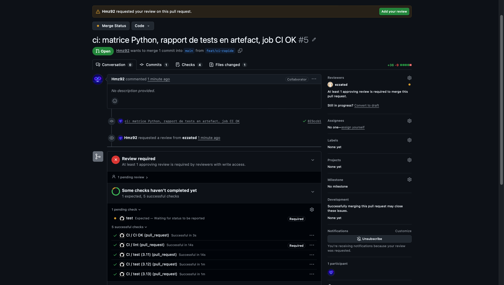
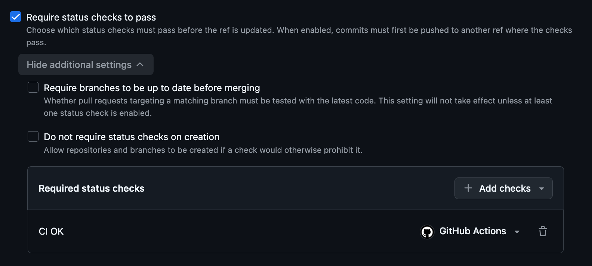
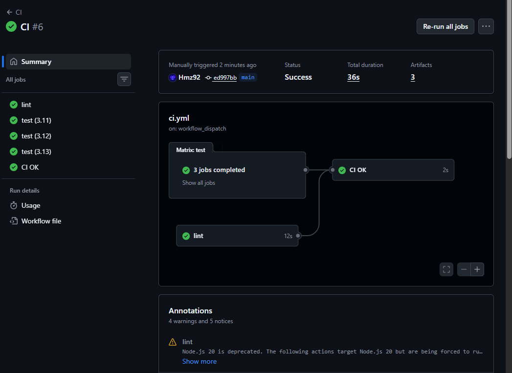
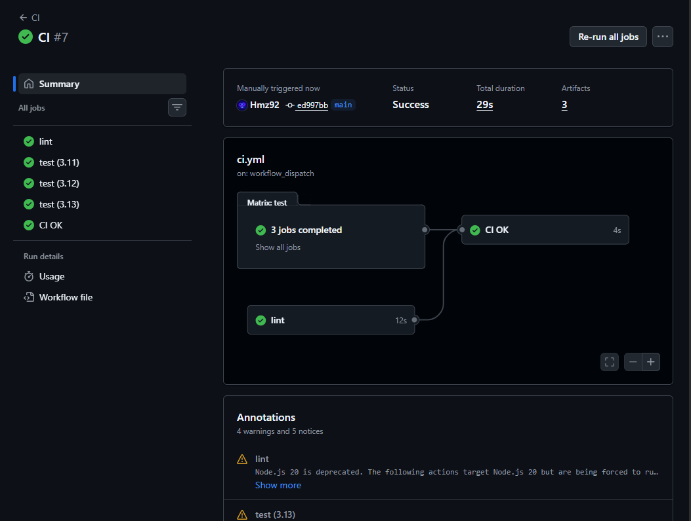
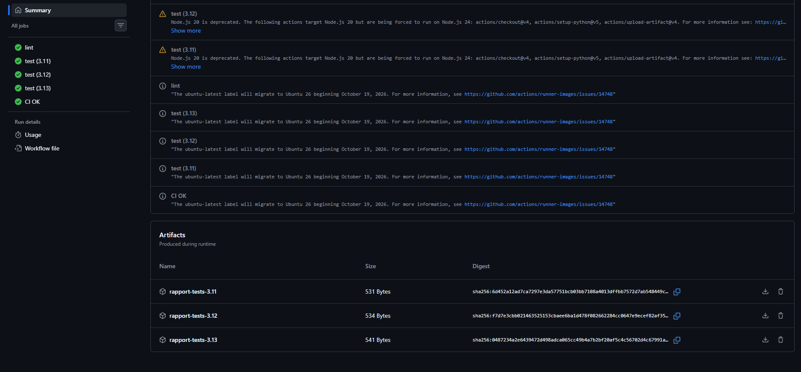
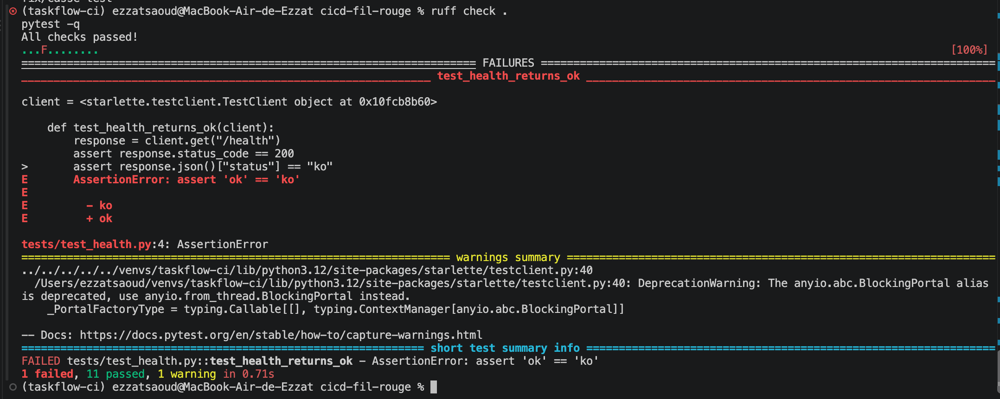
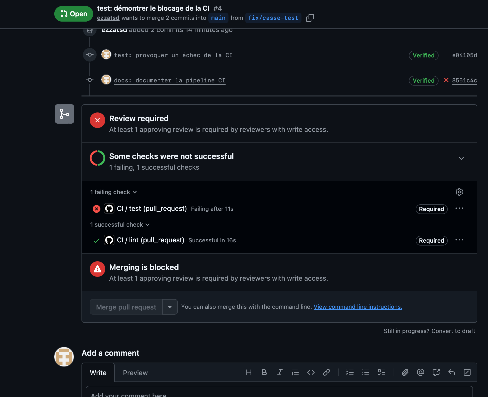
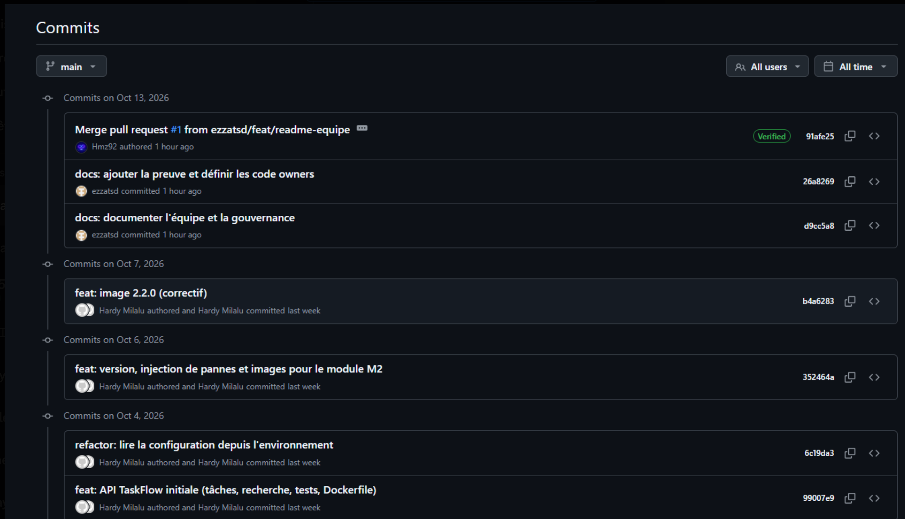
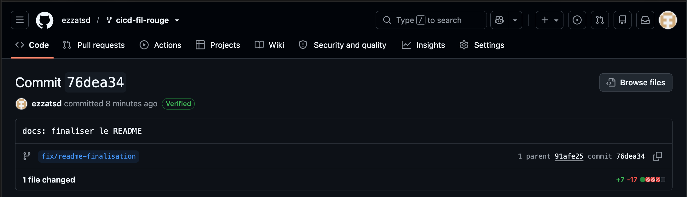

# TaskFlow — dépôt fil rouge CI/CD

[](https://github.com/ezzatsd/cicd-fil-rouge/actions/workflows/ci.yml)

TaskFlow est une petite API de gestion de tâches écrite en Python avec FastAPI.
C'est le projet fil rouge du module CI/CD (Mastère DevOps M1, Sup de Vinci) :
pendant trois jours, vous allez construire autour d'elle un pipeline complet
qui teste, construit, sécurise et livre l'application.

## Lancer l'API en local

Prérequis : Python 3.10 ou plus récent.

```bash
python3 -m venv .venv
source .venv/bin/activate          # Windows : .venv\Scripts\activate
pip install -r requirements-dev.txt
uvicorn app.main:app --reload
```

L'API répond sur [http://localhost:8000](http://localhost:8000) et sa documentation
interactive est disponible sur [http://localhost:8000/docs](http://localhost:8000/docs).

## Vérifier le code

```bash
pytest           # tests automatiques
ruff check .     # lint
ruff format .    # mise en forme
```

## Lancer avec Docker

```bash
docker build -t taskflow .
docker run --rm -p 8000:8000 taskflow
```

## Endpoints

| Méthode | Chemin | Rôle |
| --- | --- | --- |
| GET | `/health` | État de l'API et version |
| GET | `/tasks` | Liste des tâches |
| GET | `/tasks/search?q=...` | Recherche dans les titres |
| POST | `/tasks` | Crée une tâche (`{"title": "..."}`) |
| GET | `/tasks/{id}` | Détail d'une tâche |
| PATCH | `/tasks/{id}/done` | Marque une tâche comme faite |
| DELETE | `/tasks/{id}` | Supprime une tâche (en-tête `X-API-Token` requis) |

## Configuration

| Variable | Rôle | Défaut |
| --- | --- | --- |
| `APP_VERSION` | Version affichée par `/health` | `0.1.0` |
| `DB_PATH` | Fichier SQLite | `taskflow.db` |
| `API_TOKEN` | Jeton exigé pour supprimer une tâche | vide (suppression désactivée) |
| `NOTIFY_WEBHOOK_URL` | Webhook appelé à chaque création de tâche | vide (désactivé) |

## Équipe

- [@ezzatsd](https://github.com/ezzatsd)
- [@Hmz92](https://github.com/Hmz92)

## Gouvernance du dépôt

La branche `main` est protégée par un ruleset actif :

- Toute modification doit passer par une pull request afin d'assurer la traçabilité des changements.
- Une approbation est obligatoire avant la fusion afin qu'un second membre contrôle les modifications.
- Les approbations obsolètes sont annulées lorsqu'un nouveau commit est ajouté.
- Les conversations de revue doivent être résolues avant la fusion.
- La revue des Code Owners est obligatoire pour les fichiers sensibles situés dans `.github/workflows/`.
- Le contrôle `CI OK`, qui agrège tous les jobs de la CI, doit réussir avant toute fusion dans `main`.
- La suppression de `main` est interdite afin de préserver la branche principale.
- Les force pushes sont bloqués afin d'empêcher la réécriture de l'historique.

### Preuve du push direct refusé

La tentative de push direct sur `main` a été rejetée par le ruleset du dépôt :



## Pipeline CI

Le workflow `.github/workflows/ci.yml` est exécuté automatiquement pour chaque pull request
qui cible `main` et à chaque push sur `main`. Il peut également être lancé manuellement avec
`workflow_dispatch`, en choisissant d'activer ou non le cache pip.

Les jobs suivants s'exécutent en parallèle :

- **lint** : installe Python et les dépendances, puis exécute `ruff check .` afin de détecter
  les erreurs de style, les imports incorrects et certains défauts du code Python ;
- **test (3.11 / 3.12 / 3.13)** : une matrice exécute `pytest` sur trois versions de Python.
  Chaque job publie son rapport de tests au format JUnit (`rapport-tests-<version>.xml`)
  en artefact du run, même en cas d'échec ;
- **CI OK** : attend la fin de tous les autres jobs et n'est vert que si chacun d'eux a réussi.

Le pipeline utilise aussi :

- **un cache pip** (`actions/setup-python`), qui évite de retélécharger les dépendances
  à chaque exécution ;
- **une règle de `concurrency`**, qui annule un run en cours quand un nouveau commit est poussé
  sur la même branche.

### Pourquoi la PR était bloquée alors que tout était vert

Après l'ajout de la matrice, le job `test` s'appelle désormais `test (3.11)`, `test (3.12)` et
`test (3.13)`. Le ruleset exigeait encore un contrôle nommé `test`, qui n'était plus jamais
envoyé : GitHub l'affichait « Expected — Waiting for status to be reported » et la fusion
restait impossible.



### Rôle du job CI OK

Le job `CI OK` dépend de tous les autres jobs et n'est vert que si chacun d'eux a réussi :
c'est le seul contrôle obligatoire du ruleset de `main`. Ainsi, on peut ajouter, renommer ou
étendre des jobs (par exemple la matrice de versions Python) sans avoir à modifier le ruleset.



### Durée avec et sans cache

Durée totale du run, lancé manuellement sur `main` avec `workflow_dispatch` :

| Cache pip | Durée totale du run |
| --- | --- |
| Sans cache | 36 s |
| Avec cache | 29 s |





**Conclusion :** le cache pip fait passer le run de 36 s à 29 s, soit environ 7 s
(près de 20 %) de gagnées. Le gain reste modeste, car le projet a peu de dépendances
et le cache ne contient que les paquets téléchargés : pip doit quand même les installer.
Sur un projet plus lourd, ou avec la matrice qui multiplie les installations par trois,
le gain devient plus important.

### Rapports de tests en artefact

Chaque run publie trois artefacts, un par version de Python, téléchargeables en bas de la
page du run :



### Exécution réussie de la CI

La Pull Request d'ajout de la CI a exécuté les jobs `lint` et `test` avec succès :


### Preuve d'une Pull Request bloquée

Un test a été volontairement cassé sur la branche `fix/casse-test`. Le job `test` échoue,
tandis que le job `lint` réussit, et le ruleset empêche la fusion dans `main`.

L'échec a d'abord été reproduit localement : Ruff réussit, tandis que Pytest signale
`1 failed, 11 passed`.





## Preuves complémentaires

### Historique et fusion de la Pull Request

L'historique de `main` montre la fusion de la Pull Request approuvée par le binôme :



### Commit signé avec une clé SSH

Le commit de finalisation est signé avec une clé SSH et reconnu comme vérifié par GitHub :


